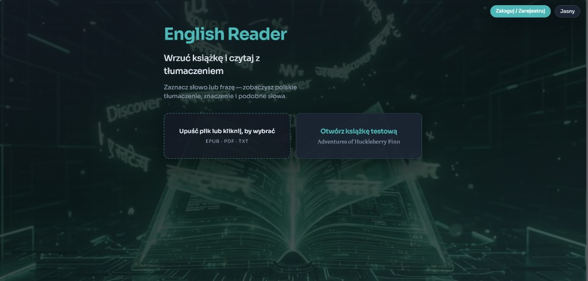
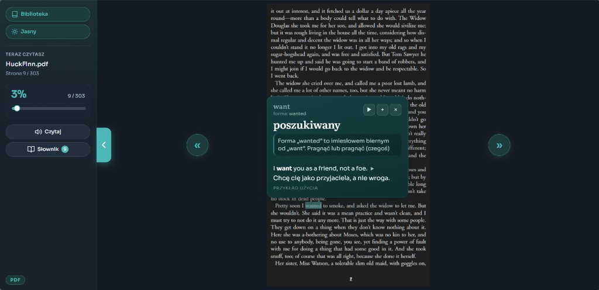
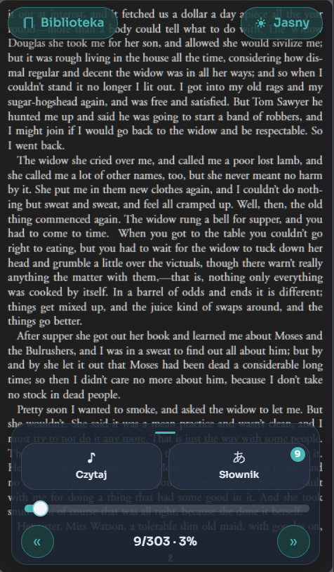
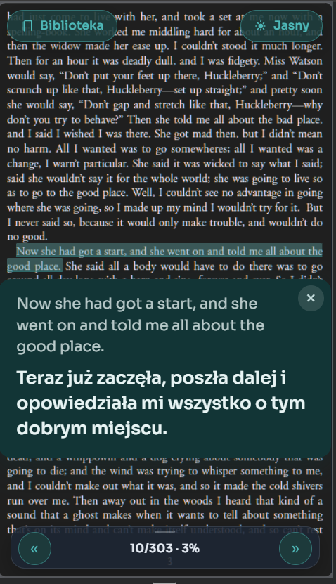

# English Reader

Aplikacja do nauki angielskiego **przez czytanie** — EPUB, PDF i TXT z natychmiastowym tłumaczeniem EN → PL, słownikiem kontekstowym i fiszkami.

> Kliknij słowo → zobacz znaczenie w kontekście. Zaznacz frazę / zdanie → pełne tłumaczenie. Zapisz do nauki.

**Live demo:** [english-reader-eight.vercel.app](https://english-reader-eight.vercel.app/)

## Demo w 30 sekund

1. Otwórz [live demo](https://english-reader-eight.vercel.app/)
2. Kliknij **Otwórz książkę testową** (Huck Finn) — bez konta
3. Kliknij słowo → popup ze znaczeniem · zaznacz zdanie → tłumaczenie

## Screenshots

<table>
  <tr>
    <td align="center" valign="top">
      <strong>Home</strong><br />
      
    </td>
    <td align="center" valign="top">
      <strong>Desktop — słowo</strong><br />
      
    </td>
  </tr>
  <tr>
    <td align="center" valign="top">
      <strong>Mobile — dock</strong><br />
      
    </td>
    <td align="center" valign="top">
      <strong>Mobile — zdanie</strong><br />
      
    </td>
  </tr>
</table>

## Funkcje

- **Czytnik**: EPUB · PDF (z cropem marginesów) · TXT
- **Tłumaczenie słowa**: popup przy tekście (hasło, gloss, przykład EN+PL)
- **Tłumaczenie zdania / zaznaczenia**: osobne okienko przy fragmencie
- **Zaznaczanie**: tap = słowo · long-press + uchwyty · double-tap = zdanie
- **Słownik Kaikki** (Supabase): formy (`feet` → `foot`), POS, przykłady
- **Fiszki** lokalnie + sync w chmurze (Supabase Auth)
- **Biblioteka** z postępem czytania (konto)

## Stack

| Warstwa | Technologie |
|--------|-------------|
| Frontend | Vite 8, React 19, TypeScript |
| Czytniki | epub.js, PDF.js |
| Tłumaczenie | Google gtx (+ fallback MyMemory) |
| Słownik | Kaikki → SQLite slim → Postgres (Supabase RPC) |
| Backend danych | Supabase (Auth, Storage książek, DB) |

## Szybki start

```bash
npm install
cp .env.example .env.local   # uzupełnij klucze Supabase
npm run dev
```

Otwórz [http://localhost:5173](http://localhost:5173), wrzuć książkę (lub `sample.txt` / `public/books/`).

Wymagania: **Node 22** (patrz `.nvmrc`).

### Zmienne środowiskowe

| Zmienna | Opis |
|---------|------|
| `VITE_SUPABASE_URL` | URL projektu Supabase |
| `VITE_SUPABASE_ANON_KEY` | Klucz anon (publiczny) |
| `SUPABASE_DB_URL` | Tylko lokalnie — import słownika (sekret, nie commitować) |
| `VITE_DICT_API_URL` | Opcjonalny fallback API słownika |

Szczegóły: [`SUPABASE_SETUP.md`](./SUPABASE_SETUP.md).

## Struktura projektu

```
src/
  components/     # UI: Reader, popupy, fiszki, auth
  readers/        # PdfReader, EpubReader, TxtReader
  hooks/          # gesty (tap / long-press), auth, theme
  lib/            # translate, selection, localDict, supabase
supabase/         # schema SQL (app + słownik)
scripts/          # kaikki-slim, import do Supabase
dict-api/         # opcjonalne API SQLite (Railway) — legacy / fallback
```

## Słownik (opcjonalnie od zera)

1. Zbuduj slim SQLite z dumpa Kaikki:  
   `npm run dict:slim -- path/to/kaikki.org-dictionary-English.jsonl.gz`
2. Uruchom SQL: `supabase/dict-schema.sql`
3. Import: `npm run dict:to-supabase` (wymaga `SUPABASE_DB_URL`)

Bez słownika apka nadal tłumaczy przez API — brakuje tylko warstwy Kaikki (formy, przykłady ze słownika).

## Skrypty

```bash
npm run dev              # development
npm run build            # produkcja
npm run preview          # podgląd builda
npm run dict:slim        # Kaikki → data/dict/en.sqlite
npm run dict:to-supabase # SQLite → Postgres
```

## Uwagi portfolio / prywatność

- Nie commituj `.env.local`, haseł DB ani pliku `en.sqlite` (~135 MB+)
- Dump Kaikki i sqlite są w `.gitignore`
- Anon key Supabase jest publiczny z założenia (RLS chroni dane użytkownika)

## Licencja

[MIT](./LICENSE) © 2026 GnizGdyni
